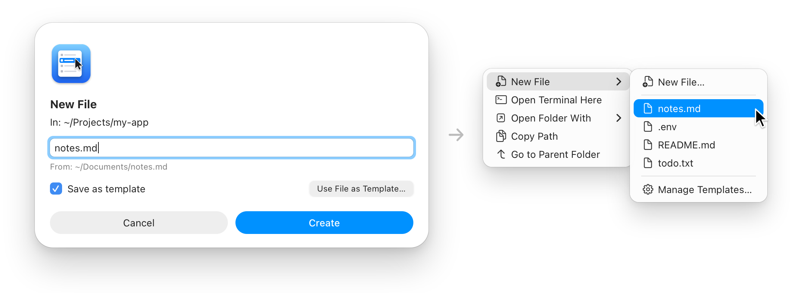
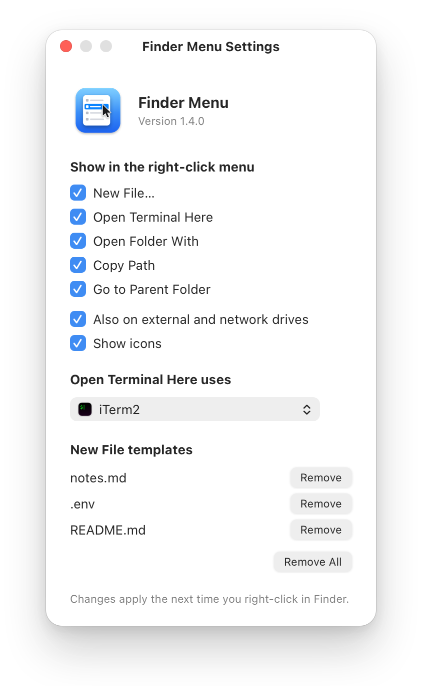

<p align="center">
  
</p>

<h1 align="center">Finder Menu</h1>

<p align="center">
  <b>The right-click options macOS is missing.</b><br>
  New File, Open Terminal Here, Open Folder With, Copy Path and Go to Parent Folder, in Finder's own menu.
</p>

<p align="center">
  <a href="https://github.com/nikgrbn/finder-menu/releases/latest"></a>
  
  
  <a href="#install"></a>
  <a href="#privacy--security"></a>
  <a href="LICENSE"></a>
</p>

<p align="center">
  <a href="#install">Install</a> ·
  <a href="#whats-in-the-menu">What's in the menu</a> ·
  <a href="#new-file-templates">Templates</a> ·
  <a href="#settings">Settings</a> ·
  <a href="#languages">Languages</a> ·
  <a href="#privacy--security">Privacy</a> ·
  <a href="#how-it-works">How it works</a>
</p>

<br>

<p align="center">
  <picture>
    <source media="(prefers-color-scheme: dark)" srcset="docs/images/menu-dark.png">
    
  </picture>
  <br>
  <sub>Right-click empty space in any folder. Finder's own items are faded here to show what Finder Menu adds.</sub>
</p>

<br>

<table>
  <tr>
    <td align="center" valign="top" width="25%"><h3>📂</h3><b>Built-in</b><br>Five actions in Finder's own right-click menu.<br><br></td>
    <td align="center" valign="top" width="25%"><h3>🧰</h3><b>Your tools</b><br>Terminals, VS Code, Cursor, JetBrains, Xcode…<br><br></td>
    <td align="center" valign="top" width="25%"><h3>🔒</h3><b>Private</b><br>No network code, no telemetry.<br><br></td>
    <td align="center" valign="top" width="25%"><h3>🪶</h3><b>Tiny</b><br>About 900 lines of Swift, built on your Mac.<br><br></td>
  </tr>
</table>

## What's in the menu

Right-click **empty space** in any folder, with nothing selected:

| &nbsp;&nbsp;&nbsp;&nbsp;&nbsp;&nbsp; | Menu item | What it does |
|:-:|---|---|
| <picture><source media="(prefers-color-scheme: dark)" srcset="docs/icons/new-file-dark.png"></picture> | **New&nbsp;File…** | Asks for a name with any extension (`notes.md`, `main.py`, `.env`), creates it in the current folder and selects it. Never overwrites. Names you use often can be [saved as templates](#new-file-templates). |
| <picture><source media="(prefers-color-scheme: dark)" srcset="docs/icons/terminal-dark.png"></picture> | **Open&nbsp;Terminal&nbsp;Here** | Opens a terminal in the current folder: iTerm2, Ghostty, Warp, WezTerm, kitty or Alacritty if you have one, otherwise Terminal. [Pick your own](#settings). |
| <picture><source media="(prefers-color-scheme: dark)" srcset="docs/icons/open-with-dark.png"></picture> | **Open&nbsp;Folder&nbsp;With&nbsp;▸** | Opens the current folder in an IDE or editor. Lists the ones you have installed (VS Code, Cursor, Windsurf, Zed, Sublime Text, JetBrains IDEs, Android Studio, Xcode…), plus **Other App…** to pick any app. |
| <picture><source media="(prefers-color-scheme: dark)" srcset="docs/icons/copy-path-dark.png"></picture> | **Copy&nbsp;Path** | Copies the current folder's full path. |
| <picture><source media="(prefers-color-scheme: dark)" srcset="docs/icons/copy-name-dark.png"></picture> | **Copy&nbsp;Name** | Copies the current folder's name, like `my-project`. Off until you turn it on in [settings](#settings). |
| <picture><source media="(prefers-color-scheme: dark)" srcset="docs/icons/parent-folder-dark.png"></picture> | **Go&nbsp;to&nbsp;Parent&nbsp;Folder** | Moves the window up one level, even when Finder's Back button is greyed out (e.g. a window opened with `open .`). |

Right-clicking a file or folder works too: **Copy Path** and **Copy Name** copy the selected items' paths or names (file names with their extensions), and **Open Terminal Here** and **Open Folder With** use the selected folder.

The menu also appears on external drives, disk images and network shares (such as SMB), not just your Mac's own disk.

On macOS 26 and later the items have icons, like Finder's own. On earlier versions Finder's items have none, so Finder Menu's don't either. The same goes for other apps' Open and Save dialogs, which show the menu too: their own items have no icons. You can turn them on or off with **Show icons** in [settings](#settings).

## New File templates

<p align="center">
  <picture>
    <source media="(prefers-color-scheme: dark)" srcset="docs/images/templates-dark.png">
    
  </picture>
</p>

1. Tick **Save as template** in the New File dialog.
2. Next time, pick it under **New File** to create an empty `notes.md` in one click.

If the name is taken, you get `notes 2.md`, like in Finder. **Manage Templates…** removes templates.

## Install

**With Homebrew:**

```bash
brew install nikgrbn/tap/finder-menu
finder-menu enable
```

**Or from source:**

```bash
git clone https://github.com/nikgrbn/finder-menu.git
cd finder-menu
./install.sh
```

Either way, the app is built on your machine, installed to `~/Applications/Finder Menu.app` and the Finder extension is turned on. There's nothing to launch: Finder loads the extension by itself, including after a restart.

> [!NOTE]
> The first time you use **Go to Parent Folder**, macOS asks whether Finder Menu can control Finder. Click **OK**, because that's how it moves the window.

### Update

```bash
brew update && brew upgrade finder-menu
finder-menu enable
```

From source, run `git pull && ./install.sh` in the repo folder.

> [!TIP]
> Don't skip `brew update`: on its own, `brew upgrade` checks for new versions only once a day.

## Settings

Open **Finder Menu** from Spotlight or your Applications folder, or run `finder-menu settings`. The settings window lets you:

- choose which items appear in the right-click menu (**Copy Name** is off until you turn it on)
- choose whether the menu also appears on external and network drives (it does by default)
- turn the menu's icons on or off (by default they follow Finder: on in macOS 26 and later, off before)
- pick the terminal for **Open Terminal Here**. Automatic uses the first one installed, in this order: iTerm2, Ghostty, Warp, WezTerm, kitty, Alacritty, Terminal. **Other App…** lets you pick any app.
- remove [New File templates](#new-file-templates)

It also shows the version you have and links to this page. **About Finder Menu** in the app menu shows the same.

<p align="center">
  <picture>
    <source media="(prefers-color-scheme: dark)" srcset="docs/images/settings-dark.png">
    
  </picture>
</p>

Changes apply the next time you right-click. You can also set the terminal from the command line: `finder-menu terminal Ghostty` (any app name works), `finder-menu terminal` to see the current choice, and `finder-menu terminal auto` to go back to automatic. If you installed from source, run `scripts/finder-menu` from the repo folder instead.

## Languages

Finder Menu uses your Mac's language, or English if it isn't one of these:

<table align="center">
  <tr>
    <td align="center" valign="top" width="160">🇺🇸 <b>English</b></td>
    <td align="center" valign="top" width="160">🇨🇳 <b>简体中文</b><br><sub>by <a href="https://github.com/yunyv">@yunyv</a></sub></td>
    <td align="center" valign="top" width="160">🇫🇷 <b>Français</b><br><sub>by <a href="https://github.com/GullmeVrn">@GullmeVrn</a></sub></td>
    <td align="center" valign="top" width="160">🇩🇪 <b>Deutsch</b><br><sub>by <a href="https://github.com/9trzj5nztr-design">@9trzj5nztr-design</a></sub></td>
  </tr>
  <tr>
    <td align="center" valign="top">🇮🇹 <b>Italiano</b></td>
    <td align="center" valign="top">🇮🇷 <b>فارسی</b><br><sub>by <a href="https://github.com/aliafshany">@aliafshany</a></sub></td>
    <td align="center" valign="top">🇷🇺 <b>Русский</b></td>
    <td align="center" valign="top">🇪🇸 <b>Español</b><br><sub>by <a href="https://github.com/LuigimonSoft">@LuigimonSoft</a></sub></td>
  </tr>
  <tr>
    <td align="center" valign="top">🇺🇦 <b>Українська</b><br><sub>by <a href="https://github.com/artemartemenko">@artemartemenko</a></sub></td>
    <td align="center" valign="top">➕ <a href="#contributing"><b>Add yours</b></a></td>
  </tr>
</table>

## Uninstall

With Homebrew:

```bash
finder-menu disable
brew uninstall finder-menu
```

From source:

```bash
./uninstall.sh
```

## Troubleshooting

- **Menu items don't appear:** hold ⌥, right-click Finder in the Dock and choose **Relaunch**. Also check that **Finder Menu** is turned on under System Settings → General → Login Items & Extensions → Finder extensions.
- **Menu items don't appear in OneDrive, Dropbox, Google Drive or iCloud Drive folders:** a macOS limitation. These apps sync through Apple's File Provider, and Finder doesn't show other apps' Finder extension menus in their folders, so other right-click menu apps are missing there too. [#29](https://github.com/nikgrbn/finder-menu/issues/29) has the details, and ideas for a way around it are welcome there.
- **Asked for permission again after reinstalling:** expected. Every build is signed locally with a new signature, so macOS asks again.
- **A drive shows the Finder Menu icon in Finder's sidebar:** expected. Finder gives every drive a Finder extension works on that app's icon, except the startup disk, so the menu can't appear on a drive without it. It's only the icon. If it bothers you, untick **Also on external and network drives** in [settings](#settings), which also takes the menu off those drives. [#14](https://github.com/nikgrbn/finder-menu/issues/14) has the details, and ideas for a way around it are welcome there.

## How it works

- `Sources/FinderMenuExtension` is a [Finder Sync extension](https://developer.apple.com/documentation/findersync) that adds the menu items to every folder. Finder only asks it about the drives it lists, so it lists every mounted drive and updates the list when one is mounted or ejected. Finder extensions must run sandboxed, so this part only reads the clicked folder and copies paths and names.
- `Sources/FinderMenu` is a small helper app that isn't sandboxed and has no Dock icon. The extension hands it actions through a `findermenu://` URL, and the helper ignores those URLs from anything else. It creates the files, opens the terminal and moves the Finder window, then quits.
- `Sources/Shared/Settings.swift` holds the list of menu items and reads the settings; `Sources/FinderMenu/SettingsWindow.swift` is the settings window. The helper writes the settings, and the extension only reads them.
- `Sources/Shared/Templates.swift` holds the New File templates (saved file names). The extension builds the New File submenu from them, and the helper looks up the chosen template by id, so the file name never travels in the URL.
- `Sources/Shared/Editors.swift` is the IDE list. The extension builds the submenu from it, and the helper refuses links naming any app that isn't on it.
- `scripts/build.sh` compiles and signs the app; `scripts/finder-menu enable|disable` copies it into `~/Applications` and turns the extension on or off. `install.sh`, `uninstall.sh` and the Homebrew formula all use these two.
- `Resources/*.lproj` holds the translations, one folder per language. `scripts/build.sh` copies them into both the helper and the extension, because the extension shows the menu titles.
- `Tests` checks the helper's path handling, the AppleScript escaping, the terminal launch arguments and the translations. `scripts/test.sh` builds and runs them, and CI runs them and a full build on every pull request.
- `scripts/make-icon.swift` draws the app icon in code and regenerates `Resources/AppIcon.icns` and `docs/icon.png`.
- `docs/mockups/mockups.html` draws the pictures in this README with HTML and CSS, and `scripts/make-mockups.swift` renders them to `docs/images` in light and dark.

## Privacy & security

You build Finder Menu yourself from this source, so there's no downloaded app to trust. Everything below can be checked in the code:

- **No network access.** There's no networking code, so nothing is sent anywhere: no telemetry, no analytics, no update checks.
- **Small enough to read.** About 900 lines of Swift and 185 lines of shell scripts (`install.sh`, `uninstall.sh` and `scripts/`). Read them before you run them.
- **Sandboxed Finder extension.** It can't read your files. It only gets the folder you right-click, the items you select, the list of mounted drives and which app owns the window under the pointer (to tell Finder from an Open or Save dialog; never a window's title or contents), plus read-only access to Finder Menu's own settings (which items to show, where, and with or without icons, plus any New File templates).
- **The helper only acts when you pick a menu item.** It creates an empty file with the name you type or a template name you saved (never overwriting anything), opens a terminal or an app in a folder, or moves the Finder window up a level.
- **Links from other apps are ignored.** The extension sends actions to the helper as `findermenu://` links. Other apps can send those links too, and so can a website after your browser asks you. Opening a folder they choose in a terminal or IDE could run code from it, so the helper checks the code signature of whatever sent each link and ignores any that didn't come from its own Finder extension. On top of that, it only acts on folders that exist, only opens apps from its built-in IDE list (or one you pick yourself), asks before a custom New File, and for templates only uses a file name you already saved (never taken from the URL).
- **One permission.** Go to Parent Folder asks once to control Finder. Finder Menu doesn't ask for Full Disk Access, Accessibility or anything else.
- **Signed locally, not notarized.** `install.sh` signs the build on your Mac ("Sign to Run Locally"). It isn't notarized by Apple, because there's no download for Apple to check.

Found a security problem? Please report it privately, as described in [SECURITY.md](SECURITY.md).

## Contributing

Bug reports and pull requests are welcome. Run `scripts/test.sh` before opening one.

- **Translations:** copy `Resources/en.lproj` to `Resources/<code>.lproj`, translate the text in it, add the code to `CFBundleLocalizations` in both `Resources/*-Info.plist` files, and open a pull request. `scripts/test.sh` tells you if a key, a `%@` or the language code is missing.
- **README pictures:** they're mockups, not screenshots. Edit `docs/mockups/mockups.html`, then run `swift scripts/make-mockups.swift`.

## License

[MIT](LICENSE)
